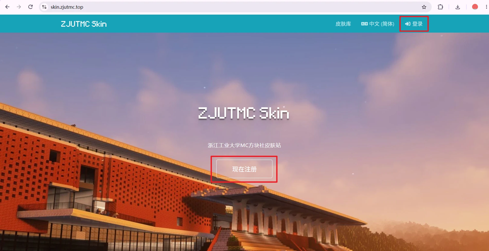
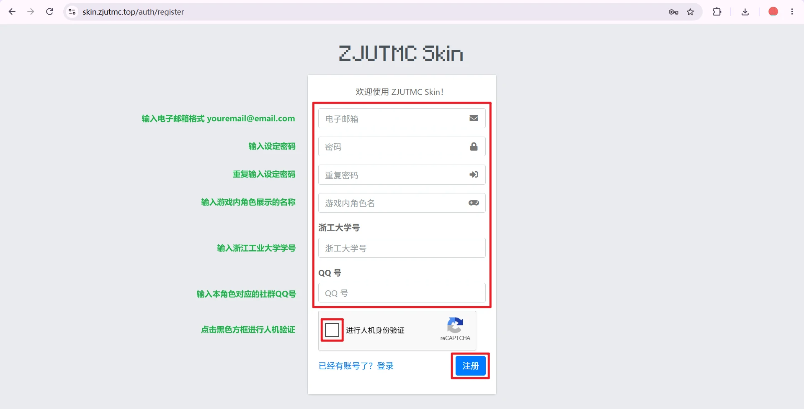
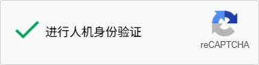

+++
title = "浙江工业大学MC方块社皮肤站使用指南"
description = "了解浙工大 MC 方块社皮肤站的注册、角色管理、皮肤设置等使用方法。"
summary = "从注册账号、创建角色到设置皮肤；LittleSkin 用户可直接阅读快速开始部分。"
draft = false
weight = 10
showTableOfContents = true
showHero = false
+++

> **编写中：本文仍待核对与补充，请以社团最新通知为准。**

社团皮肤站用于管理 Minecraft 角色的皮肤与披风。本文主要面向 Java 版玩家，介绍通用操作；具体按钮名称、注册要求和客户端配置，请以皮肤站当前页面及社团服务器说明为准。

**皮肤站地址：[skin.zjutmc.top](https://skin.zjutmc.top/)**

> **用过 LittleSkin？可以先看下面的快速上手。** 社团皮肤站与 LittleSkin 均基于 Blessing Skin Server，角色管理、皮肤库和衣柜等操作有相似之处，但两站是不同服务，账号、角色、材质和登录状态不互通。

## LittleSkin 用户快速开始

如果你已经熟悉 LittleSkin，可以跳过后面的注册与使用基础说明，按下列步骤逐项检查即可：

1. 打开 [浙江工业大学MC方块社皮肤站](https://skin.zjutmc.top/)，按本站要求**单独注册并登录**，其他皮肤站账号均无法直接登录。
2. 在角色管理中创建或确认角色，使角色名与实际使用方式、服务器要求一致。
3. 上传自己的皮肤，或在本站皮肤库中选择材质，加入衣柜后应用到目标角色。
4. 阅读本文的[客户端与服务器配置](#client-server-config)，确认使用社团提供的客户端、皮肤加载方案或外置登录方案。

## 开始之前

请先区分三个易被混淆的概念：

| 概念 | 用途 | 注意事项 |
| --- | --- | --- |
| 皮肤站 | 管理角色与材质的网站 | 不是专供皮肤下载的皮肤中心，其账号不等于微软账号，也不应默认与其他皮肤站账号互通 |
| 角色 | 接受皮肤、披风设置的游戏身份 | 角色名与客户端、服务器的对应方式取决于实际登录方案 |
| 皮肤与披风 | 角色使用的外观材质 | 上传或收藏后，通常还需要应用到具体角色 |

> **在网页上设置成功，不等于所有客户端和服务器都会自动显示。** 是否显示，还取决于客户端皮肤加载方式、外置登录配置以及服务器支持情况。

本站不是 Minecraft 官方服务，不会因此修改微软账号中的官方皮肤，也不提供 Minecraft 正版购买凭证。

## 一、注册并登录

1. 打开 [浙江工业大学MC方块社皮肤站](https://skin.zjutmc.top/)。

    

2. 可使用页面右上方的语言菜单切换为所需语言。

3. 点击“现在注册”；如已注册账号，点击登录。

    

4. 按页面要求填写所有信息，完成人机验证，点击注册。

    

    

5. 注册完成后，使用本站账号登录。

    [前往登录页面](https://skin.zjutmc.top/auth/login)

## 二、创建与修改角色

登录后，系统会自动跳转至用户中心仪表盘，在这里可以看到总览信息。
左侧菜单栏提供了多种工具管理皮肤站账号内容，右上角功能键分别为：切换深浅主题色、未读信息、切换语言、账号信息。

1. 注册皮肤站账号时，系统已按提交的游戏内角色名创建角色，默认为Steve皮肤，无披风。
2. 要链接到正版账号，点击"用户中心-仪表盘"，点击右侧正版绑定"验证"按钮，网页会跳转到Microsoft网站等待授权验证。完成后该皮肤站账号即绑定正版账号，角色会同步当前正版账号上使用的皮肤和披风。
3. 要修改角色外观，点击"用户中心-我的衣柜"，点击"上传材质"，按提示上传Minecraft皮肤使用的PNG材质文件，而不是人物效果截图。选择模型时，请区分 Steve／默认模型（宽手臂） 与 Alex／纤细模型（细手臂），查看预览以确认皮肤模型正确。上传完成后，回到"用户中心-我的衣柜"，在"皮肤"栏目下选择已上传或收藏的皮肤，点击右侧预览框下方"使用..."添加到指定角色。常见 Java 版皮肤尺寸为 `64×64`，传统皮肤也可能是 `64×32`；不要仅把普通图片改名为 `.png` 后上传。请尊重原作者，不要未经允许转载、冒充原创或公开他人的私有材质，本皮肤站仅为正常游玩游戏代为保存皮肤。修改角色披风方式以此类推。本站上传的披风不等于微软或 Mojang 官方披风，也不能保证自定义披风在未配置支持的客户端中显示。
4. 要修改角色名称，点击"用户中心-角色管理"，点击角色名修改图标，修改角色名称。修改正版账号对应角色的角色名称会导致皮肤站因无法找到同名角色而无法同步正版账号上使用的皮肤和披风，请谨慎操作。
5. 要创建新角色，点击"用户中心-角色管理"，点击"添加新角色"，按要求添加新角色。每添加一个新角色需要消耗100皮肤站积分，可添加的新角色数量可以从仪表盘"使用情况-角色数量"栏目下 x/y  得到，x为已有角色数量，y为当前积分下支持拥有的角色总数量。

建议使用符合 Minecraft Java 版常见规则的角色名，例如英文字母、数字和下划线。

**不要随意删除、重建或改名。** 角色名称或身份变化可能影响服务器中的玩家识别；有进度、背包或白名单记录时，请先咨询服务器管理员。

## 三、客户端与服务器配置 {#client-server-config}

请优先使用社团提供的客户端或整合包，并遵循对应服务器的入服说明。如果已有配置正常工作，不要因为教程提到某个模组而重复安装或改动登录方式。

### 情况 A：社团客户端已经配置好

1. 按社团说明启动客户端，使用指定的账号或角色。
2. 在皮肤站确认皮肤已应用到正确角色。
3. 重启游戏或重新进入服务器，检查显示效果。

如果仍然不显示，先阅读下方的排查清单，不要立刻更换角色或删除账号。

### 情况 B：自行配置皮肤加载

使用 CustomSkinLoader 等皮肤加载模组时，需要匹配 Minecraft 版本与模组加载器，并按管理员说明添加本站皮肤源。

**安装模组不代表它会自动读取社团皮肤站。** LittleSkin 可能存在预置支持，但不能据此假定社团皮肤站也在默认加载列表中；本站皮肤源的地址、顺序和配置以维护者提供的信息为准。

这类方案主要解决客户端如何获取皮肤，不等于服务器登录认证，也不会自动让所有其他玩家看到你的皮肤；其他玩家的客户端同样需要具备对应支持。

### 情况 C：服务器要求外置登录

仅在社团明确启用并提供外置登录说明时使用此方案：

1. 在支持相应认证方式的启动器中，添加管理员提供的认证服务器。
2. 检查认证地址确实属于社团指定服务，不要沿用 LittleSkin 的地址。
3. 按启动器提示使用本站凭据登录，并选择正确角色。
4. 通过该账号启动游戏，连接支持这一认证方式的服务器。

**本文暂不提供未经核实的认证地址。** 如果没有找到社团发布的配置说明，请先咨询管理员，不要猜测接口路径，也不要向不明认证服务器提交密码。

<!-- 编辑者补充区：核实后在此加入实际启动器操作、认证地址及截图，或删除不适用的方案。 -->

## 常见问题

### 为什么网页预览正常，游戏里却没有皮肤？

按顺序检查：

1. 是否把皮肤应用到了正确角色，而不只是上传或收藏。
2. 当前启动器账号、所选角色与服务器要求是否一致。
3. 客户端是否已配置本站皮肤源，或按要求使用了正确的外置登录服务。
4. 模组版本、加载器和游戏版本是否匹配。
5. 网络能否访问本站，是否仍在使用缓存；可以等待片刻并重启游戏再试。

不要将“游戏里暂时不显示”直接理解为需要重新注册账号。

### 为什么我能看到皮肤，其他玩家却看不到？

不同客户端可能使用不同的皮肤来源。请让对方确认其客户端是否支持并配置了本站；仅在你自己的客户端安装模组，通常不能改变其他玩家的显示方式。

### 为什么手臂或身体贴图错位？

检查是否选错 Steve／Alex 模型，以及上传的文件是否确实为对应尺寸与布局的皮肤材质。重新选择模型或更换正确材质后再预览。

### LittleSkin 账号为什么不能直接登录？

两站虽然使用相近的软件，但不应默认共享账号或数据库。请按本站要求单独注册；如果管理员另外提供了迁移或绑定功能，以该功能说明为准。

### 设置后是否能在任意服务器显示？

不能保证。本站管理的是本站材质及相关角色设置，最终显示受客户端和服务器配置影响；基岩版、官方账号皮肤和第三方皮肤加载也不是同一套使用流程。

### 忘记密码或遇到其他问题怎么办？

如果登录页提供“忘记密码”，可按提示找回；否则联系管理员。求助时请提供：

- 发生问题的步骤和完整错误提示。
- 启动器、Minecraft 版本及模组加载器。
- 使用的角色名称，以及是否使用社团客户端。
- 必要的界面截图，注意遮挡邮箱、令牌、密码和其他隐私信息。

可通过社团公布的渠道联系管理员；社团 QQ 群为 **763729280**。

## 为什么看起来和 LittleSkin 很像？

社团皮肤站使用 [Blessing Skin Server](https://github.com/bs-community/blessing-skin-server)。[LittleSkin](https://littleskin.cn/) 首页也说明其基于定制的 Blessing Skin Server，因此两者在页面结构、角色与材质管理思路，以及默认青色界面风格上有相似之处。

**这是共用开源技术基础，不代表社团皮肤站属于 LittleSkin，也不代表两站共享账号、数据或所有功能。** LittleSkin 的定制功能、运营规则、认证服务和默认客户端适配，不能直接视作本站已经具备的能力。
