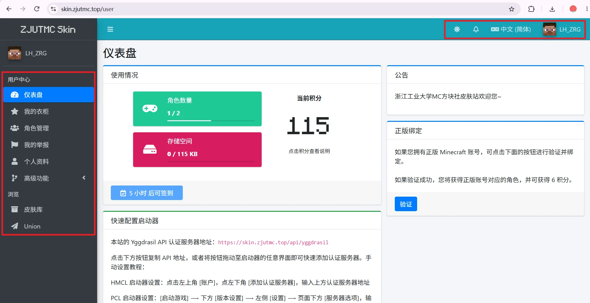
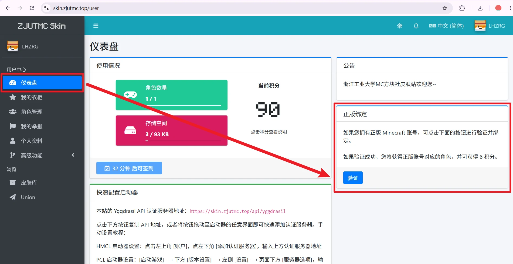
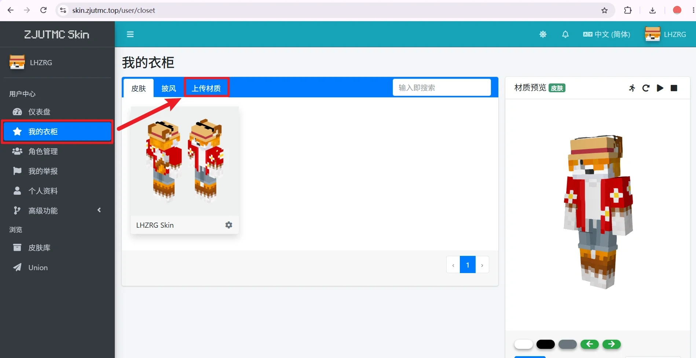
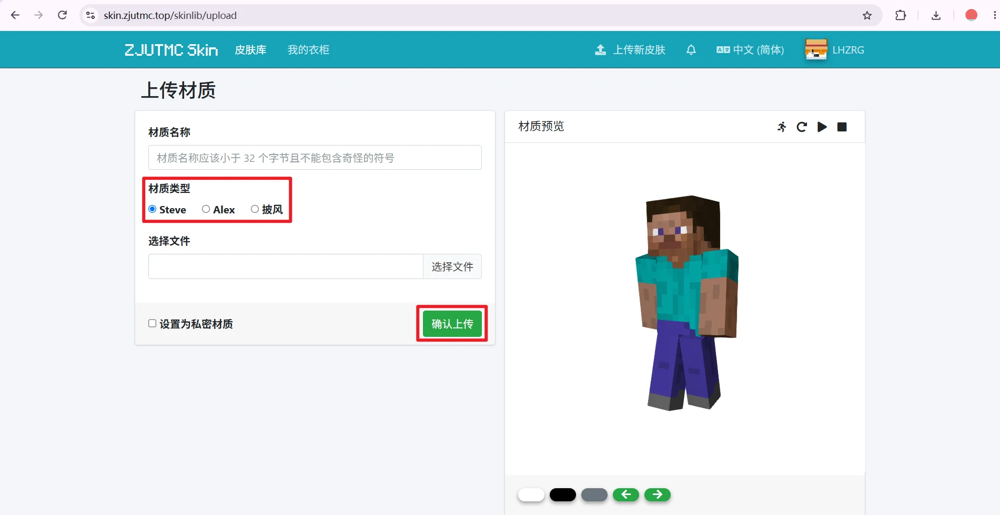
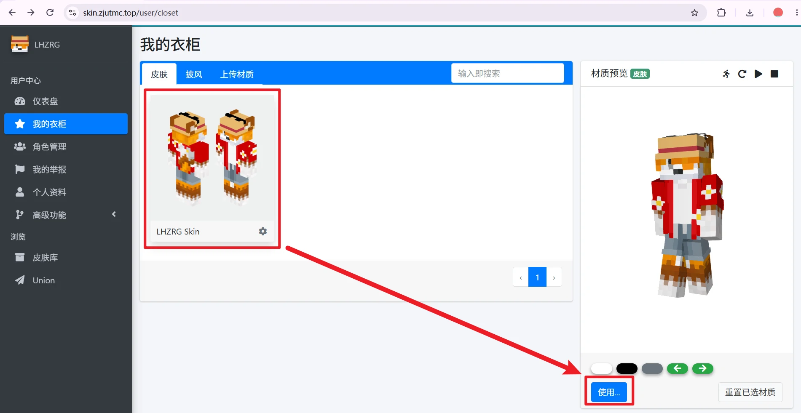
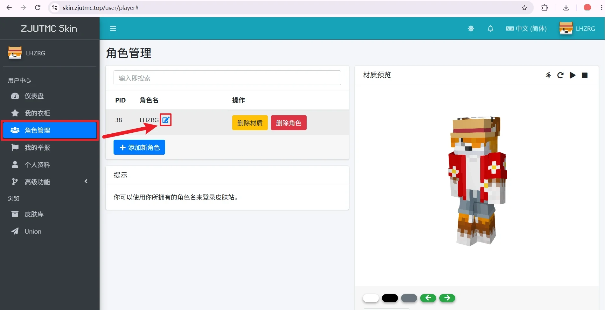
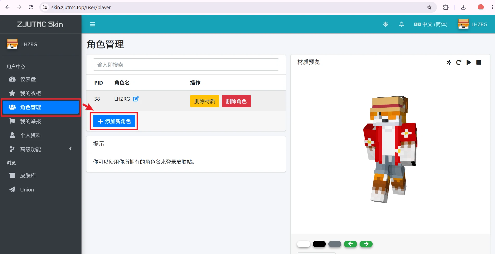
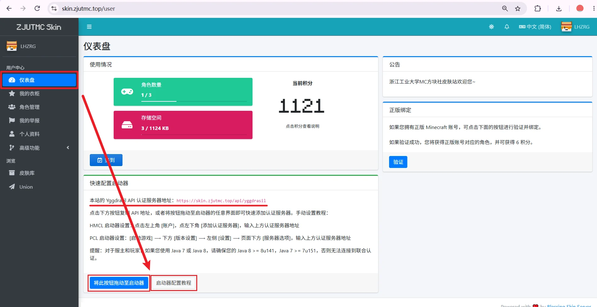

+++
title = "浙江工业大学MC方块社皮肤站使用指南"
description = "了解浙江工业大学MC方块社皮肤站的注册、角色管理、皮肤设置等使用方法。"
summary = "从注册账号、创建角色到设置皮肤；LittleSkin 用户可直接阅读快速开始部分。"
draft = false
weight = 10
showTableOfContents = true
showHero = false
+++

社团皮肤站用于管理 Minecraft 角色，同时为角色添加皮肤与披风。本文面向 Java 版玩家。

**皮肤站地址：[https://skin.zjutmc.top](https://skin.zjutmc.top/)**

## LittleSkin 用户快速开始

本社团皮肤站与 LittleSkin 均基于 Blessing Skin Server，操作有诸多相似之处，但**两站数据不互通**。如果你已经熟悉 LittleSkin，按下列步骤逐项检查即可：

1. 打开 [浙江工业大学MC方块社皮肤站](https://skin.zjutmc.top/)，按社团皮肤站要求**注册账号并登录**，其他皮肤站账号均无法直接登录。
2. 在角色管理中创建修改角色，使角色名与实际使用方式、服务器要求一致。
3. 上传自己的皮肤，或在社团皮肤站的皮肤库中选择材质，加入衣柜后应用到目标角色。
4. 阅读本文的[客户端与服务器配置](#client-server-config)，确认使用社团提供的客户端与登录方案。

## 新用户从这里开始

### 开始之前
请先区分三个未详细了解时易被混淆的概念：

| 概念 | 用途 | 注意事项 |
| --- | --- | --- |
| 皮肤站 | 管理角色并提供验证的网站 | 不是专供下载皮肤材质的皮肤网站，但网站内有玩家上传的材质 其账号不是正版账号，也不默认与其他皮肤站账号互通 |
| 角色 | 接受皮肤与披风设置的游戏身份 | 角色名与客户端、服务器的对应方式取决于实际登录方案 |
| 皮肤与披风 | 角色使用的外观材质 | 上传或收藏后，需要应用到具体角色 |

在网页上设置成功，不等于所有客户端和服务器都会自动显示。是否显示，取决于客户端皮肤加载方式、外置登录配置以及服务器支持情况。

社团皮肤站不提供 Minecraft 官方服务，也不会修改正版账号中的皮肤与披风，更不提供 Minecraft 正版账号的购买与验证凭证。

### 一、注册并登录

1. 打开 [浙江工业大学MC方块社皮肤站](https://skin.zjutmc.top/)。

2. 可使用页面右上方的语言菜单切换为所需语言。

3. 点击“现在注册” ；如已注册账号，点击登录。

    

4. 按下图页面要求填写所有信息，完成人机验证，点击注册。

    

5. 完成账号注册如下图所示。使用社团皮肤站账号登录。

    

    点击这里 → [前往登录页面](https://skin.zjutmc.top/auth/login)

### 二、创建与修改角色

登录后，系统会自动跳转至用户中心仪表盘，在这里可以看到总览信息。

1. 注册皮肤站账号时，系统已按提交的角色名创建角色，默认为Steve皮肤，无披风。

2. 要绑定正版账号，点击"用户中心-仪表盘"，点击右侧正版绑定"验证"按钮，网页会跳转到 Microsoft 网站等待授权验证。完成后该皮肤站账号即绑定正版账号，角色会同步正版账号上使用的皮肤和披风。

    

3. 要修改角色外观，点击"用户中心-我的衣柜"，点击"上传材质"，按提示上传 Minecraft 皮肤使用的PNG材质文件 (而不是人物效果截图) 。选择模型时，请**区分 Steve／默认模型（宽手臂）**与 **Alex／纤细模型（细手臂）**，查看预览以确认皮肤模型正确。  

    

    

    上传完成后，回到"用户中心-我的衣柜"，在"皮肤"栏目下选择已上传或收藏的皮肤，点击右侧预览框下方"使用..."添加到指定角色。

    

    > 常见 Java 版皮肤尺寸为 `64×64` 或 `64×32`；不要仅把普通图片改名为 `.png` 后上传。  

    > 请尊重材质原作者，不要未经允许转载、冒充原创或公开他人的私有材质，本皮肤站仅代为保存材质。皮肤站上传的披风不等于微软或 Mojang 官方披风，也不能保证自定义披风在未配置支持的客户端中显示。

4. 要修改角色名称，点击"用户中心-角色管理"，点击角色名修改图标，修改角色名称。

    

    > 修改正版账号对应角色的角色名称会导致皮肤站因无法找到同名角色而无法同步正版账号上使用的皮肤和披风，请谨慎操作。

5. 要创建新角色，点击"用户中心-角色管理"，点击"添加新角色"，按要求添加新角色。每添加一个新角色需要消耗100皮肤站积分。

    

    > 建议使用符合 Minecraft Java 版常见规则的角色名，例如英文字母、数字和下划线。

    > **不要随意删除、重建或改名。** 角色名称或身份变化可能影响服务器中的玩家识别；有进度、背包或白名单记录时，请先咨询服务器管理员。

### 三、配置皮肤加载 {#client-server-config}

请优先使用社团提供的客户端，遵循对应服务器的入服说明。如果配置正常工作，不要额外重复安装模组或改动登录方式。

关于启动器验证配置，详阅[PCL启动器使用指南]() 

#### 使用社团客户端配置皮肤加载

1. 按入服指引说明，将客户端导入启动器，使用指定的账号或角色。
2. 在皮肤站确认皮肤已应用到正确角色。
3. 点击"用户中心-仪表盘", 在"快速配置启动器"栏目下选择合适的方式配置启动器登录方式。

    

#### 自行配置皮肤加载

使用 CustomSkinLoader 等皮肤加载模组时，需要匹配 Minecraft 版本与模组加载器，有时可能需要添加社团皮肤站皮肤源。

> **安装模组不代表它会自动读取社团皮肤站。**社团皮肤站皮肤源的地址、顺序和配置以维护者提供的信息为准。

## 皮肤站功能详细介绍

左侧菜单栏提供了多种工具管理皮肤站账号内容，右上角功能键分别为：切换深浅主题色、未读信息、切换语言、账号信息。

### 仪表盘

#### 使用情况

总览角色数量、存储空间和当前积分。皮肤站现已支持上传高清皮肤和披风。

角色数量下有 x/y ，x为已有角色数量，y为当前积分下支持拥有的角色总数量。

积分细则请前往皮肤站点击积分查看。

#### 公告

查看皮肤站最新公告

浙江工业大学MC方块社皮肤站欢迎您~

#### 快速配置启动器

拖拽按钮快速配置启动器登录，或手动配置认证服务器。

#### 正版绑定

将已登录的皮肤站账号链接到微软正版账号。绑定完成后同步正版账号上使用的皮肤和披风。

### 我的衣柜

#### 皮肤

查看自己已上传、由正版账号导入和收藏的由其他玩家上传的皮肤。

点击齿轮设置键，可以重命名皮肤、将皮肤从衣柜中移除、在皮肤库中查看该皮肤、将当前皮肤设为皮肤站账号头像。

[皮肤站皮肤库](https://skin.zjutmc.top/skinlib)

#### 披风

查看自己已上传、由正版账号导入和收藏的由其他玩家上传的披风。

点击齿轮设置键，可以重命名披风、将披风从衣柜中移除、在披风库中查看该披风。

[皮肤站披风库](https://skin.zjutmc.top/skinlib?filter=cape)

#### 上传材质

上传个性化皮肤与披风的入口。

#### 材质预览

预览当前可用的皮肤与披风。在皮肤与披风页面点击需要的材质，预览窗口就会自动显示。

右上角功能键分别为：切换行走/奔跑、旋转/停止旋转、暂停动作/播放动作、重置动作。

左下角功能键分别为：将背景设置为白色/黑色/灰色，左右切换游戏背景。可用的游戏背景有：平原河岸、恶地山谷、洞穴、风袭丘陵、冻河、冰原、人工建筑。

点击"使用..."将材质应用到角色。点击"重置已选材质"将清空材质预览里已选的材质，重置为 Steve 。

### 角色管理

#### 角色管理

搜索账号下的角色，查看角色PID，修改角色名，删除角色材质，删除角色。

#### 材质预览

基本功能与"我的衣柜"中的"材质预览"相同。

点击"切换 2D/3D 预览"，可以查看当前角色材质的平面图和立体图。

### 我的举报

查看在皮肤库中提交的举报工单。

### 个人资料

#### 更改头像

详细说明了如何更改皮肤站账号头像。

点击"重置头像"将重置头像为 Steve 。

#### 更改昵称

更改皮肤站账号昵称，该修改**不会影响账号内已创建的角色名**。

#### 更改密码

修改皮肤站账号密码。

#### 更改邮箱

修改皮肤站账号邮箱。邮箱一栏默认**显示当前已绑定的邮箱**。

要修改邮箱，请删除当前邮箱，输入新邮箱，再输入密码进行校验。

> 启动器配置认证服务器为社团皮肤站时，启动游戏需要账号绑定的邮箱登录，请谨慎修改。

#### 删除账号

删除社团皮肤站账号。**该操作无法恢复**，请谨慎操作。

### 高级功能 - OAuth2 应用

#### OAuth2 应用

编者也不知道这个怎么用喵...

### 皮肤库

查看社团皮肤站内所有玩家上传且公开的材质，允许其他玩家收藏、应用和下载。

材质详情页可以查看名称、适用模型、Hash值、文件大小、上传者、上传日期信息。

材质详情页的材质预览基本功能与"我的衣柜"中的"材质预览"相同。可以快速设置为账号头像、下载材质和举报材质。

### Union

社团皮肤站现已接入 MUA Union，所有 MUA Union 联合认证支持的服务器均可显示。

#### 角色绑定和冲突检查

适用于在 MUA Union 其他皮肤站注册了相同名称角色的玩家。详细说明了该情况如何处理。

#### 站点安全性

显示当前站点在 MUA Union 联合认证中的评级。

#### ID:xxx

用于查看当前账号下当前角色在联合认证中的基础信息和 UUID 。允许通过获取 Token 的方式将其他账号绑定到主账号。

#### 皮肤站列表

查看 MUA Union 联合认证中所有支持的皮肤站。

## 常见问题

### 为什么网页预览正常，游戏里却没有皮肤/披风？

请按顺序依次检查：

1. 是否把皮肤/披风应用到了正确角色，而不只是上传或收藏。
2. 当前启动器账号与应用了皮肤/披风的角色是否一致。
3. 客户端是否已配置社团皮肤站的皮肤源，或按要求使用了正确的皮肤加载。
4. 模组版本、加载器和游戏版本是否匹配。
5. 网络能否访问社团皮肤站，是否仍在使用缓存；可以等待片刻并重启游戏再试。

仍存在问题请联系管理员。

### 为什么我能看到皮肤，其他玩家却看不到？

不同客户端可能使用不同的皮肤来源。请让对方确认其客户端是否支持并配置了社团皮肤站；仅在你自己的客户端完成配置，通常不能改变其他玩家的显示方式。

### 为什么手臂或身体贴图错位？

检查是否选错 Steve／Alex 模型，以及上传的文件是否确实为对应尺寸与布局的皮肤材质。重新选择模型或更换正确材质后再预览。

### 为什么皮肤站看起来和 LittleSkin 很像？

社团皮肤站使用 [Blessing Skin Server](https://github.com/bs-community/blessing-skin-server)。[LittleSkin](https://littleskin.cn/) 首页也说明其基于定制的 Blessing Skin Server，因此两者在页面结构、角色与材质管理思路，以及界面风格上有相似之处。

**这是共用开源技术基础，不代表社团皮肤站属于 LittleSkin，也不代表两站共享账号、数据或所有功能。** LittleSkin 的定制功能、运营规则、认证服务和默认客户端适配，不能直接视作本站具备。

### LittleSkin 账号为什么不能直接登录？

两站配置近似，但不共享账号或数据库。请按皮肤站要求单独注册。

### 设置后是否能在任意服务器显示？

不能保证。皮肤站管理站内材质及相关角色设置。社团皮肤站现已接入 MUA Union，所有 MUA Union 联合认证支持的服务器均可显示。

### 忘记密码或遇到其他问题怎么办？

如果登录页提供“忘记密码”，可按提示找回；其他情形请联系管理员。

求助时请提供：

- 发生问题的步骤和完整错误提示。
- 启动器、Minecraft 版本及模组加载器。
- 使用的角色名称，以及是否使用社团客户端。
- 必要的界面截图，注意遮挡邮箱、令牌、密码和其他隐私信息。

